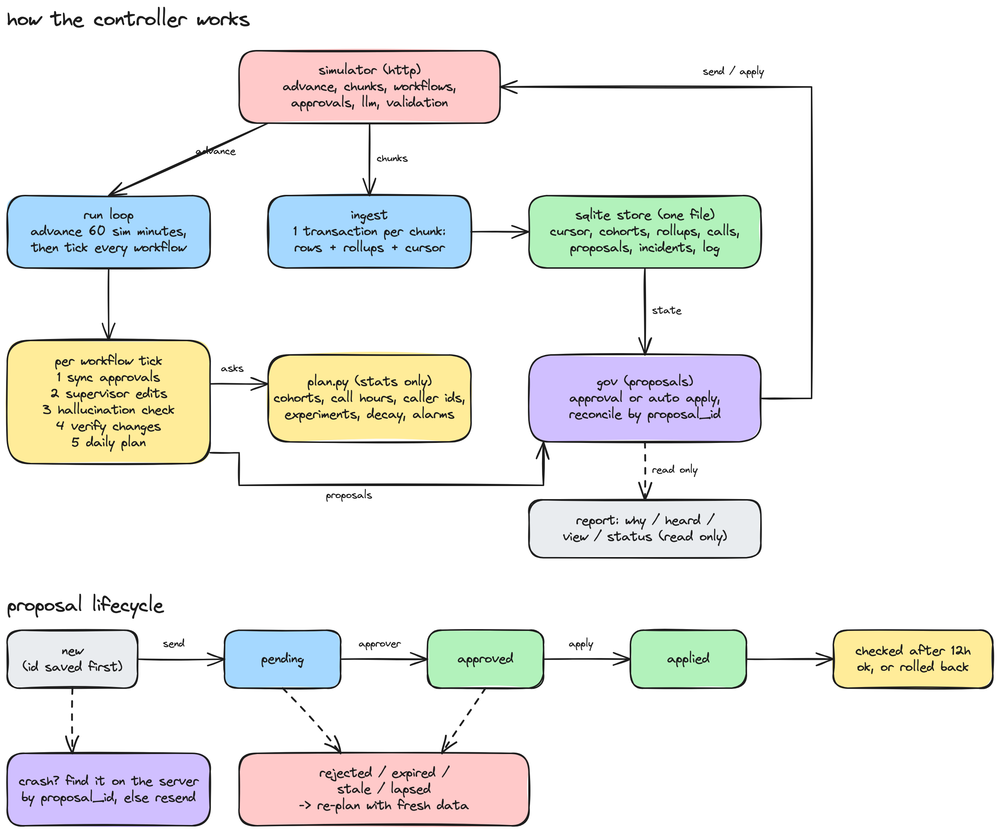

# outcome-first agent loop, submission

name: guthala rajkumar. date: 2026-11-09. hours actually spent: 10 hours. language and storage: python 3.12, sqlite (stdlib sqlite3), numpy and httpx which were already in requirements.txt. no new dependencies.

---

## 0. tl;dr

one python process drives the simulator one hour at a time. every chunk goes into sqlite in one transaction with its rollups. per workflow it runs five things: call time weights per cohort, caller id spreading and spam flag detection, welcome and voice experiments with a winner rule i calibrated, a hallucination fix that goes back to the last good prompt with validation evidence, and a check after every change that rolls back if a kpi drops.

public_01: conclusion rate +15.3% vs the no-op baseline, 0 harmful changes. public_02: +28.6%, also 0 harmful. the bad supervisor prompt was fixed in 150 minutes. the spam flagged caller id was out of rotation in 3 hours. only 3 credits used. crash test: killed 6 times with sigkill, it still finished clean.

not built: per person call time, prompt optimisation outside incidents, a ui (the supervisor view is a cli), fairness across tenants.

## 1. assumptions

1. the simulator api is the only truth. the controller reads policy from `GET /workflows`, never from scenario files.
2. one controller owns one simulator. if the store has a different scenario name, or its cursor or clock is ahead of the simulator, i treat it as a new world. the old db gets renamed and a new one starts.
3. guardrails are relative drops. `pickup_rate_max_drop: 0.02` means dont lose more than 2% of the pickup rate. this is the stricter reading.
4. guardrails are checked on the same hours of the previous 2 days. pickup changes about 3x across the day so comparing different hours is wrong.
5. a person's features never change. so a feature key (`lang|tier|age|value`) is enough to put any lead in any cohort later.
6. anything the customer hears (welcome message, voice, prompt) always goes through approval, even on kestrel where policy allows auto apply. schedule and caller id auto apply only where the policy allows.
7. a safety incident is the only case where we propose a change on something the supervisor just edited. it still goes to their approval with evidence. nothing gets overwritten silently.
8. explore safely for caller ids means a new number starts at 5% and needs at least 90% of the other numbers' pickup before it gets a full share.
9. a caller id pulled for a sudden pickup drop stays pulled till a person clears it (`python -m controller unban`). carriers dont clear flags on any schedule we know.
10. approver hours from `governance.approver_hours` are the client's working hours. normal requests go out 1 hour after start, so 11:00 for 10:00 approvers. that also covers anita's never before 11.
11. history before D0 ran on the business default (W1, V1). so history tells us pickup by hour, caller id load and normal flag rates. it tells us nothing about other variants.

## 2. scope decisions

| # | capability | built / partial / cut | why | what it would take to finish |
|---|---|---|---|---|
| C1 | event ingestion | built | everything depends on it. one transaction per chunk: rows, rollups and cursor together | streaming parse for chunks bigger than memory |
| C2 | shared cohort object | built | one cohort list (age x language, fixed from history) used by scheduling, experiments, checks and the view | pick the split from data after a few weeks of variant data |
| C3 | bootstrap from history | built | call time profiles, caller id baselines, flag rate baselines and known good prompts all come from the 14 history days | nothing |
| C4 | call time optimisation | partial | per cohort hour weights, with a replay that checks the engagement guardrail before proposing. per person only one rule: people who already said no go to the last hour | per person hours for returning people, once we can show one person's history predicts their hour |
| C5 | caller id health | built | spread load, 5% probes, sudden drop detector, rotate right away | carrier flag api instead of guessing from pickup |
| C6 | variant experiments | built | factorial for free (welcome and voice are sampled independently), probability matching with floors, a calibrated move rule, ramp caps | a model for welcome x voice interactions |
| C7 | promotion, decay, rollback | built | hourly decay detector, explore again after decay, rollback from post change checks | faster decay detection for cohort overrides, today only the default allocation is watched |
| C8 | hallucination response | built | two tier detector, known good prompt first, llm as fallback, validation evidence, check after apply | testing prompts with a holdout, which is hard with one prompt per workflow |
| C9 | governance client | built | state machine with crash reconcile, batching, approver hour timing, fatigue caps with a slot kept for incidents, re-plan when stale | learn each approver's latency to time requests better |
| C10 | honest impact and dry runs | partial | dry runs replay recent observed rates. impact is the estimated relative lift on the primary kpi on a fixed scale | off-policy replay with propensity weights |
| C11 | supervisor view | partial | `python -m controller view <wf>`: tests, winners, what's waiting on approval, today's changes, pulled numbers. cli not ui | a web page on the same queries |
| C12 | audit store | built | `why`, `heard`, and every decision in a `log` table | nothing |
| C13 | crash recovery shown | built | `tests/crash_test.py`, output in `reports/crash_recovery.md` | nothing |
| C14 | loop observability | partial | `ticks` table and `python -m controller status`: ingest rate, decision time, credits, open proposals, alerts | push metrics to the prometheus they already run |
| C15 | fair allocation across tenants | cut | credits never came close to running out (3 of 200 used) and approver attention is per workflow in the policy anyway | per tenant credit budget and one global queue sorted by impact |

how i picked: build what moves outcomes or stops harm on a regulated client, and make all of it auditable. pickup levers (caller ids, timing) gave the biggest wins so i built them fully. experiments got the most stats care because that's where a false winner hurts a cohort. anything that's just a view on top of the store (ui, dashboards) got the thinnest version.

## 3. stakeholders

### 01. sales (nikhil)

accepted: speed where it's safe. caller id spreading and call time weights auto apply where policy allows, and they gave the biggest numbers (ks_cancel conclusion +58% on public_02).

pushed back:
- one blended score. product and the readme both say dont blend pickup and engagement. so we report one lift per kpi per workflow.
- winning by lunch, live by evening. one morning is a few hundred connected calls. my a/a test shows a naive pick the best rule moves on pure noise about a third of the time.

wrong claims in the memo:
- kestrel has auto apply for everything: not true. `ks_cancel` auto apply only allows schedule, caller id, welcome and voice, and each change is capped at a 0.2 shift. prompt changes need approval plus validation evidence.
- northwind is fine with auto apply on kyc: not true. `nw_kyc` has auto apply turned off, and northwind compliance wants a named approval for anything customer facing.
- the persuasive prompt tested well: in one of my nw_renewal runs P4 (persuasive) failed validation at 0.963. the bar is 0.97.

> nikhil, you will have real numbers for the summit. on the incident scenario kestrel's cancellation line concluded 58% more leads than the untouched agent, and every client line went up. i cant give you one blended score. pickup and engagement are kept separate on purpose and the client contracts say so. two corrections before you say it on stage: kestrel's auto apply covers timing, caller ids and small welcome and voice changes, not prompts. and northwind kyc has auto apply off. the persuasive prompt failed our safety validation on northwind so it wont go there. happy to build the slide with you.

### 02. northwind compliance (meera)

accepted all of it:
- anything customer facing needs approval.
- prompt changes carry a `validation_run_id`.
- `python -m controller heard <person_id>` answers what did this customer hear and why, from our own store. it shows the variant, config version, proposal and approval.
- normal requests go out at 11:00 and stay inside 10:00 to 19:00 (kyc 10:00 to 18:00).
- slow and right became the move rule. we only move traffic when we are 97% sure it's not a loss and the expected lift is at least 2%. harmful changes stayed at 0 on both public scenarios.

wrong claim in the memo: the policy covers timing and caller id rotation only on renewal. on kyc auto apply is off completely, so even a caller id rotation goes to your approver. we do that, and we mark caller id incidents as urgent.

> meera, everything you asked for is in place. anything a customer hears (welcome, voice, script) only changes after one of your approvers says yes, and script changes come with a validation run id. for an audit we can answer what did customer x hear on day d and why from our own records in seconds: the variant, the config version, who approved it and the evidence. one correction: on kyc the policy doesnt cover caller id rotation. auto apply is off there, so those changes also come to your approvers. the weekly summary will list every timing and caller id change on renewal with the reason.

### 03. platform and sre (kabir)

accepted: survives kill (shown), idempotent everywhere, no new stateful infra. state is one sqlite file per controller. on the load scenario one simulated day takes 20 to 36 seconds wall time including the simulator, budget is 10 minutes (section 8). alerts are few and each one says what to do (section 10).

pushed back: nothing really. one tradeoff: sqlite means one writer, so one controller process per shard. fine at this scale. at 10x it means splitting by tenant (section 8).

> kabir, the loop survives kill -9 at any point. the test kills it six times during the incident scenario and it still finishes with every event stored once, no change applied twice and no approval lost (reports/crash_recovery.md). no new infra. state is one sqlite file next to the process, so nothing new to page anyone about at 2am. load scenario: under 40 seconds wall time per simulated day and about 1 gb ram. at 10x the single writer is the limit. the fix is one process per tenant group, or moving the same tables to your postgres.

### 04. kestrel ops (anita)

accepted:
- your prompt edits never get undone silently. whatever a supervisor touches is frozen for 48 hours.
- max two normal requests a day, never before 11:00, everything batched into one.
- customer facing changes come to you even though kestrel's policy would let us auto apply welcome and voice.
- one screen: `python -m controller view ks_cancel`.
- a fix that kills engagement gets caught. every prompt fix is checked after apply and the incident reopens if engagement falls. this happened once in testing with the strict near verbatim prompt.

pushed back on one thing: when your P2 edit started hallucinating (5.7% flagged calls vs 1.5% normal) we asked you to revert it within about 90 minutes, with the evidence. we didnt wait 48 hours.

wrong claim in the memo: the policy actually allows 4 requests a day from 10:00. we follow your stricter ask anyway.

> anita, we wont touch your prompt changes behind your back and we wont flood you. max two requests a day, never before 11, everything in one request. anything a customer hears comes to you first even though your policy would let us skip that. one exception you should know: if a prompt change makes the bot make things up (your P2 edit on day 3 got flagged on 5.7% of calls vs 1.5% normal) we will ask you to roll it back that same afternoon with the numbers attached. you still decide. your screen is `view ks_cancel`: what's being tested, what's winning, what's waiting on you and what changed today.

### 05. product (tara)

accepted:
- separate kpis: pickup and engagement are tracked and reported separately everywhere.
- one shared cohort object: fixed once from history and used by every part of the loop.
- every proposal has an impact score, a diff, an affected lead count and a dry run.
- expired or rejected counts as a rejection and gets re-planned with fresh data.
- evidence: learning only reads the variant recorded on each call event, never the allocation we meant to set.
- winners stay inside their workflow.

on the open questions, what i picked and why:
- minimum sizes: 150 connected calls before an arm counts as tried, 300 before a cohort gets its own allocation, and 300 recency weighted calls before an arm can take more than 25% of traffic.
- evaluation window: 5 days, with a 1.5 day half life.
- what it costs: the move rule finds a +13% arm about half the time at 300 calls per arm, and 93 to 95% of the time at 1000. on pure noise it makes a neutral move 6 to 13% of the time, and moves away from a true best 0 to 2% of the time. details in section 5.

pushed back: per person call time as p0. the data is a few attempts per person per campaign. that's anecdote, not population. what i shipped instead: per cohort call hours, plus moving people who already said no to the end of the day.

> tara, all your definitions are kept, and the cohort is one object everywhere. the view, the experiments and the audit show the same ids. minimum sizes and windows are written up with what they cost: the winner rule finds a 13% better variant about 93% of the time once each arm has a day's volume, and on pure noise it moves traffic 6 to 13% of the time, rarely to something worse. i didnt build per person call time. one person gives us 3 to 8 calls a campaign, too thin to beat the cohort's pattern, and i dont want an anecdote on the summit slide. caller id health and the supervisor view are built.

### 06. cto (aryamann)

accepted:
- explainable over clever: every change has a rationale, evidence and a `why` trail.
- credits only where they change a decision: 3 credits for the whole incident scenario. the llm isnt called when a known good prompt exists.
- choosing: written in section 2.
- on call docs: `docs/RUNBOOK.md`.

what breaks first at scale is in section 8.

> aryamann, short version: five things built properly, the rest cut or kept thin on purpose (section 2). zero harmful changes on both public scenarios. the incident scenario used 3 credits, because the controller goes back to a prompt it has seen on 20,000 calls before it asks an llm for ideas. every change can be explained from our own store with `python -m controller why <workflow> <time>`. what breaks first at 10x is the one sqlite writer and one python process. the fix is splitting by tenant, which is easy because no state crosses workflows. i would rather show you a live `why` than a slide.

## 4. architecture



drawn in excalidraw. the editable file is `docs/controller.excalidraw`, open it on excalidraw.com to change it.


state lives only in sqlite. on restart it opens the db, reads the cursor, lists chunks after the cursor (not the `new_chunks` of an advance that might be lost), ingests them, then reconciles every open proposal with the simulator using its fixed `proposal_id` (`<wf>-<minute>-<tag>`). experiment state is not stored separately. it gets recomputed from rollups every time, so it cant be forgotten. what is stored: cohort definitions, caller id bans, decay flags and how far we have read supervisor edits.

## 5. the learning loop

cohorts. built once per workflow from history leads: age band x language, one cohort per cell that has at least 2% of leads, then one age only fallback per age band. with three languages that's 16 cohorts, under the cap of 20. age drives the hour of day pickup pattern we see in history. language is the natural place for voice and welcome effects, and it's the example in the contract. i control fragmentation with shrinkage, not with fewer cohorts. a cohort gets its own allocation only when it has 300 recent connected calls and its shrunk posterior (a prior worth 200 calls, centred on the global arm lifts) is more than 0.15 total variation away from the default.

experiment design. welcome and voice are sampled independently per call, so every allocation is already a factorial design. arms are analysed marginally. interactions are not modelled (known weakness). the first plan keeps the current arm at 60% and splits 40% across untried arms. after that allocation is probability matching on a beta posterior with a 3% floor per arm. the floor keeps every arm measured, which is how decay gets noticed. two fixes, both found from harmful changes in early runs:
- stratification: global comparisons only use calls from cohorts on the default allocation for that dimension. pooling across cohort overrides gave a simpson's paradox false winner.
- recency: evidence is weighted with a 1.5 day half life, because effects decay.

deciding a winner. a new allocation is used only if P(new mix beats current mix) >= 0.97 and the posterior mean lift is at least 2%. arms with less than 300 weighted calls are capped at 25%, so they ramp up instead of jumping. a/a calibration using the repo's own `choose()` with 3 arms:

| rule | current arm share | a/a moves (n=300 / 1000) | finds a +13% arm | harmful moves when current is best |
|---|---|---|---|---|
| P(lift>0) >= 0.9 (naive) | 60% | 31% / 33% | 81% / 100% | not measured |
| P(lift>2%) >= 0.95 (first try) | 60% | 5.0% / 2.0% | 48% / 87% | not measured, it got stuck on a real +3.6% gain |
| P(beats) >= 0.97 and mean lift >= 2% (shipped) | 80% | 7.8% / 6.0% | 48% / 93% | 1.2% / 0.0% |
| same rule | 60% | 13% / 9% | 54% / 95% | 2.0% / 0.8% |

a/a moves are neutral, they only shuffle traffic between equal arms. multiple comparisons across cohorts and dimensions are handled by the shrinkage and the 0.97 bar, not bonferroni. per decision the harmful move rate is 0 to 2%, and there are about 1 or 2 decisions per workflow per day.

decay and rollback. an hourly rollup (`vh`) checks every live arm with at least 30% share: last 24 hours vs the 72 hours before. decay is flagged at a drop of 10% or more with z < -3. then for 3 days:
- the decayed arm is judged only on its last 24 hours,
- arms with thin recent data get explored again,
- the move bar drops to 0.8,
- a proposal outside the daily plan is allowed.

on public_02 the decaying W3 on nw_renewal went from 94% to 18% of its calls within a day of detection.

call time and caller id.
- call time: hour weights per cohort come from 21 days of `hours` rollups. each cohort's hourly rate is shrunk 100 dials toward the global hour shape, squared, normalised to mean 1, and floored at 0.05 so no hour is ever zero. before proposing, a replay predicts pickup and the engagement of the connected mix. if engagement would drop more than half the guardrail, the sharpening steps down from 2 to 1 to 0.5.
- caller ids: spread evenly across healthy numbers, because pickup drops fast as one number gets more load. that's the biggest single pickup lever, nw_kyc pickup +23%. new numbers start at 5% and graduate at 150+ dials and at least 90% of the others. a number gets pulled when the last 6 hours (or 24) show it below 75% of the others and below 75% of its own last 4 days (z < -3). the second check stops us banning a number that's just carrying more load.

guardrail, three layers:
1. the schedule replay checks the guardrail before proposing.
2. every applied schedule or caller id change is checked after 12 hours and 300 connected calls, against the same hours of the previous 2 days. a breach (ratio < 1 - tolerance, z < -3) rolls it back on its own.
3. on workflows with an engagement guardrail (kyc), people who connected and said no in a live campaign get moved to the last dialling hour.

the third one exists because better pickup means more repeat connects from people who already said no. in an early run repeat connects went from 12.5% to 16.4% of connected calls, and that alone cost about 2% engagement. with it, nw_kyc engagement is -0.6% (public_01) and -1.7% (public_02) while pickup is up 19 to 23%. inside the 2% guardrail but not by much (section 13).

## 6. governance

the proposal lifecycle is the bottom half of the diagram in section 4 (`docs/controller.png`).


- batching: one normal plan per workflow per day, with every dimension that moved enough: allocation total variation >= 0.1 (caller id >= 0.04), or schedule weights moving more than 0.3. nothing is sent while another approval for that workflow is open, except incidents.
- timing: normal requests go out at approver start + 1 hour and stop 1 hour before close, so the latency lands inside working hours and the hourly poll meets the 2 hour apply window. incidents go out right away.
- fatigue: normal requests are capped at `min(max_requests - 1, 2)` per 24 hours, so there's always a slot left for an incident. incidents can use the full policy cap.
- auto apply: only for schedule and caller id, only where the policy allows those dims, and only when no approval is open (it would make it stale), except an urgent caller id rotation. shifts are stepped to stay under `max_shift`. weights are sent as exact k/1024 fractions because the simulator re-normalises floats. before that fix, tiny float drift made an untouched dim look changed and 41 auto applies got refused.
- impact score: estimated relative lift on the primary kpi from the dry run, divided by 10%, clipped to 0.05 to 1. incidents are fixed at 0.9. exploration shows up around 0.05, which is honest, we dont know yet.
- affected leads: active leads (campaigns still inside cadence, minus concluded) in the cohorts whose allocation changes, or all of them for default and schedule changes.
- dry runs: replay over observed data (posterior arm means per cohort, per number pickup over the last 24 hours, cohort x hour pickup with the engagement mix). they ignore the eligible pool running down and the load change from moving caller id volume, and they say so.
- supervisor edits: seen from `config_changed` events. whatever they touched is frozen for 48 hours. anything of ours in flight goes stale at apply and gets re-planned around their edit. experiment data stays valid because learning uses the variant recorded on each call.

## 7. incidents

hallucination detector. runs every hour on the live prompt, a poisson tail test against a normal flag rate.
- established prompt (2000+ connected calls of history): baseline is that prompt's own rate. fires at p < 1e-7, 2x baseline, 300+ calls, 24 hour window. an earlier 1e-4 threshold fired once on pure noise in public_01 (24 flags in 596 calls on P1) and caused the only prompt related harmful change i saw. that's why this tier exists.
- new prompt: baseline is the pre D0 rate for the workflow. fires at p < 1e-3, 1.5x, 100+ calls, 12 hour window. this only runs in the hours after a prompt change, so it adds about a 2% false alarm chance per prompt change. fair price for catching a bad script in about 90 minutes.

picking the fix. first choice is the best prompt with 1000+ connected calls and a normal flag rate (we know its engagement), validated with n=300 (3 credits). only if there's none do we call `/llm/suggest-fixes` (3 credits) and validate suggestions one by one till one passes. the validation run id is the evidence on the approval request.

checking the fix. after 200 calls on the fix the detector runs on it again and engagement is compared with history. if either fails the incident reopens with that prompt excluded. in one early run this caught the llm's strict near verbatim suggestion killing engagement.

credits: 3 on public_02 and 0 on public_01, out of 200.

timeline on public_02, from `log`:

| sim time | what happened |
|---|---|
| D2 10:00 | (hidden) ks_cancel caller id D2 gets spam flagged |
| D2 13:00 | D2 pickup 17.7% vs about 27% for the others and its own history. pulled from rotation by auto apply |
| D3 11:30 | (hidden) supervisor ships P2 on ks_cancel |
| D3 12:00 | supervisor edit logged, prompt frozen for normal plans |
| D3 13:00 | detector fires: 10 flags in 176 calls (5.7% vs 1.5%, p=4.8e-4). P1 validated at 0.987 (3 credits). approval sent |
| D3 13:23 | approved. applied at the D3 14:00 tick (simulator mttr 150 min) |
| D3 17:00 | checked: P1 at 0.4% flags on 281 calls, incident closed |
| D4 13:00 | nw_renewal W3 decay detected, explore again. W3 down to 18% of its calls on D5 |
| D5 15:00 | (hidden) supervisor sets nw_renewal voice V2 100%. our request in flight goes stale, voice frozen 48 hours, nothing undone |

## 8. scale

measured on public_03_load (12 workflows, about 840k events a day) on an m-series laptop:

| measure | value |
|---|---|
| wall time per simulated day (simulator + ingest + decisions) | 20 to 36 s (budget 600 s) |
| ingest throughput | 69k to 96k events/s |
| decision time per day, 12 workflows | 1.1 s, going up to 8.6 s by D4 |
| decision lag | at most 1 tick (60 sim minutes). ingesting one hour of load takes about 0.4 s |
| peak memory | 1.02 gb rss |
| whole run including 5.5M history events | 175 s |
| outcome | conclusion +19.3%, 52 changes, 0 harmful |

full numbers in `reports/public_03_load.md`.

where it breaks at 10x (8.4M events a day, 120 workflows):
1. the single sqlite writer and python json parsing go first. at about 90k events/s that's about 90 s per simulated day. still inside budget but no room for bursts.
2. decision queries grow with workflows x cohorts. they read rollups so the cost is per workflow not per event. the one query that reads raw `calls` (people who already said no) is the reason decision time grows per day, and it's the first one to move into a rollup.
3. raw `calls` storage, about 0.9 gb per 5 days now, about 9 gb at 10x. it's only needed for `heard`. partition it by day and drop it after the audit retention period.

splitting is easy because nothing crosses workflows. run one controller per tenant group, each with its own db (or its own postgres schema), on the same event source. the rollups move to postgres as they are since they're plain upserts.

## 9. reliability

crash test (`python tests/crash_test.py scenarios/public_02_incidents.yaml`, output in `reports/crash_recovery.md`). sigkill at D0 15:00, D2 08:00, D3 14:00 (in the middle of the incident), D3 15:00, D5 14:00 and D7 16:00. then 7 starts and a clean finish. what it checks, each measured on its own and not from the controller's counters:
- every event after history is stored exactly once,
- history rollups match a count of call events in the raw chunks,
- D0 onward rollups match the raw call rows,
- no `proposal_id` shows up twice in any config history,
- every approval on the server is known to the controller and none is left approved and unhandled,
- cohorts survive.

result: PASS.

what we lose on a crash: at most the in memory work of the current tick, and that gets recomputed. if it dies between a successful `/validation/runs` call and the db write, it validates again and pays the credits again. that's the one call that isnt idempotent, it costs 3 credits.

idempotency keys:
- chunks: `eat()` itself refuses a chunk number at or behind the cursor.
- proposals: fixed `<wf>-<minute>-<tag>` id. a duplicate 409 gets reconciled through `GET /approvals` or the config history.
- applies: `not_approved` on apply gets resolved through config history.

simulator errors: 5xx and connection errors retry with backoff, up to 10 times. 4xx gets saved on the proposal as `failed` with the body and raises an alert, with a 3 hour backoff on that tag. 402 (out of credits) stops the incident step and alerts, and the incident stays open for a person.

## 10. audit and observability

the question why did ks_cancel change at 14:00 on D3, who approved it and what happened next, asked live:

```
$ CONTROLLER_DB=state/public_02_incidents.db python -m controller why ks_cancel D3 14:00

D3 14:00  v7  by controller_approved  dims=['prompt_version']
  proposal ks_cancel-5100-incident (approval, incident) made D3 13:00
  summary: Switch prompt P2 -> P1: hallucination flags 5.7% vs 1.5% normal
  why: 10 flagged calls out of 176 on P2 in the last 12h (p=4.8e-04). P1 passed validation at 0.987 and has 20455 connected calls of history.
  impact 0.9, affected leads 3540, evidence {'validation_run_id': 'val_00001'}
  approved: apr_00009 decided 2027-01-07T13:23:00+05:30 reasons []
  after: 7864 connected; pickup x0.953 (z -4.3), engagement x1.000 (z 0.0) vs same hours before
    D3 17:00 incident: fixed: P1 flag rate 0.4% on 281 calls, took 4h from detection
    D4 02:00 verified: ks_cancel-5160-plan: pickup x0.984, engagement x0.939 vs same hours before
    D4 11:00 proposed: auto ks_cancel-6420-plan: ks_cancel: caller id D1 50% D3 50%

D3 14:00  v8  by controller_auto  dims=['caller_id']
  proposal ks_cancel-5160-plan (auto, plan) made D3 14:00
  summary: ks_cancel: caller id D1 30% D3 70%
  why: daily plan at D3 14:00; welcome_message: p(best) W1 48% W2 14% W3 37%; voice: p(best) V1 23% V2 11% V3 34% V4 32%
```

`python -m controller heard <person_id>` lists every call that person got with the variant, config version and cohort. then for each config version it shows who set it, the summary, the reason and the approval id. that's the irdai question.

would page (`log.kind in ('alert','send_failed','lapsed')`, shown by `status`):
- a proposal refused at send (4xx),
- an approved change that lapsed,
- an incident stuck with no prompt left to try,
- credits under 20,
- ingest falling behind (the gap in `ticks` grows).

would not page: rejections (re-planned on their own), stale applies (re-planned), caller id rotations and decay flags (they show in the morning view), plans blocked by fatigue caps (logged once a day).

## 11. results

public_01 (`reports/public_01.md`):

| workflow | conclusion change | pickup change | engagement change | gap captured |
|---|---|---|---|---|
| ks_cancel | +13.8% | +7.7% | +3.3% | 23% |
| nw_kyc | +20.8% | +20.4% | -0.6% | n/a |
| nw_renewal | +13.8% | +7.8% | +4.1% | 19% |
| all | +15.3% | +10.1% | +3.0% | 16% |

24 changes applied: 10 beneficial, 14 neutral, 0 harmful. 0 credits.

public_02 (`reports/public_02.md`):

| workflow | conclusion change | pickup change | engagement change | gap captured |
|---|---|---|---|---|
| ks_cancel | +58.5% | +39.0% | +8.6% | 38% |
| nw_kyc | +23.3% | +23.3% | -1.7% | n/a |
| nw_renewal | +9.4% | +9.8% | -1.2% | 13% |
| all | +28.6% | +23.7% | +1.6% | 25% |

30 changes applied: 12 beneficial, 18 neutral, 0 harmful. bad prompt mttr 150 min. spam flagged number at 0% share from the day after the flag. 3 credits.

where we helped: pickup, mostly from spreading caller id load. and on ks_cancel by getting off the flagged number and the hallucinating prompt fast.

where we were weakest:
- nw_renewal engagement on public_02 (-1.2%) is from the decaying W3. we pushed it to 94% on D2 because it really was the best arm then. it decayed from D3 and we only got it under 20% on D5.
- nw_kyc engagement is close to its guardrail (section 5).

how it got to zero harmful. early versions applied up to 6 harmful changes per run. i traced each one to a cause and fixed it:
- a caller id that lost its evidence once we stopped dialling it,
- float re-normalisation drift,
- simpson's paradox in pooled arm comparisons,
- floor arms getting treated as untried,
- a prompt alarm triggered by noise,
- a rollback that put a banned number back,
- jumps on thin data.

results move between runs because the simulator uses one rng across all workflows, so any change reshuffles every outcome. treat single run differences under about 2% as noise.

## 12. trade-offs and rejected alternatives

| option | why considered | why rejected, what instead |
|---|---|---|
| sqlmodel orm | my first draft used it | new dependency, and inserting one object at a time is way too slow for 850k events a day. stdlib `sqlite3` with `executemany` does 90k+ events/s |
| postgres or redis | sre already runs them | not needed for one process. the tables move over as they are when we split |
| storing raw history calls | easier audit | 5.5M rows of business default calls nobody audits. rollups only |
| naive P(best) >= 0.9 winners | standard bandit rule | moves on a/a noise about 33% of the time. replaced with the calibrated rule |
| 40% re-exploration on every short window | faster decay response | caused harmful moves. now only arms thin on recent data get explored, and only while a decay flag is up |
| llm first incident fixes | the readme flow | costs credits and the suggestions have unknown engagement. known good prompt first, llm as fallback |
| auto applying welcome and voice on kestrel | policy allows it | anita asked to see customer facing changes first. approval latency there is only 20 to 120 min |
| caller id bans with a timer | re-probe numbers | re-probing a flagged number was a harmful change every time. manual `unban` instead |
| per person call time | product p0 | 3 to 8 calls per person per campaign is anecdote. per cohort weights plus moving people who said no |

## 13. known weaknesses

- kyc engagement guardrail margin is thin: -1.7% on public_02 against -2%. it comes from higher pickup reaching people who already said no, not from a variant. the post change check would roll back one change that breaches, but slow drift across many good changes doesnt get pinned on any one of them.
- decay at cohort level: the detector only watches arms in the default allocation. a cohort override that decays is only caught through its posterior, which is slower.
- welcome x voice interactions are not modelled. if W2 only works with V3, the marginal analysis undersells that pair.
- check windows overlap. two changes applied within 12 hours of each other get judged on the same after window, so a rollback can hit the wrong one. caller id bans are protected from this, schedule changes are not.
- no prompt optimisation outside incidents. the grounded prompt might be better, but with one prompt per workflow a test is a before and after comparison, and this design doesnt count that as evidence.
- no per tenant credit budget. with 12 workflows sharing 400 credits, a burst of llm fallback incidents could starve a later one. in practice known good first keeps spend tiny.
- a validation call lost to a crash gets paid twice.

## 14. if this went to production at formi next month

1. week 1: run it in shadow on two northwind workflows. it writes proposals to its store but never sends them. compare its decisions with what the supervisors actually did.
2. move storage to the postgres they already run (same tables) and split by tenant, so one bad tenant cant slow the others.
3. replace spam detection from pickup with the carrier's flag feed where there is one. keep the pickup check as fallback.
4. week 2: turn on sending for caller id and timing changes only, on renewal, where policy already allows auto apply. watch `status` and the check log every day.
5. ship the `view` output as a small page for supervisors, plus the weekly change summary meera asked for (a query over `props` and `log`).
6. only then turn on welcome and voice experiments, one client at a time, starting with whichever approver responds fastest.
